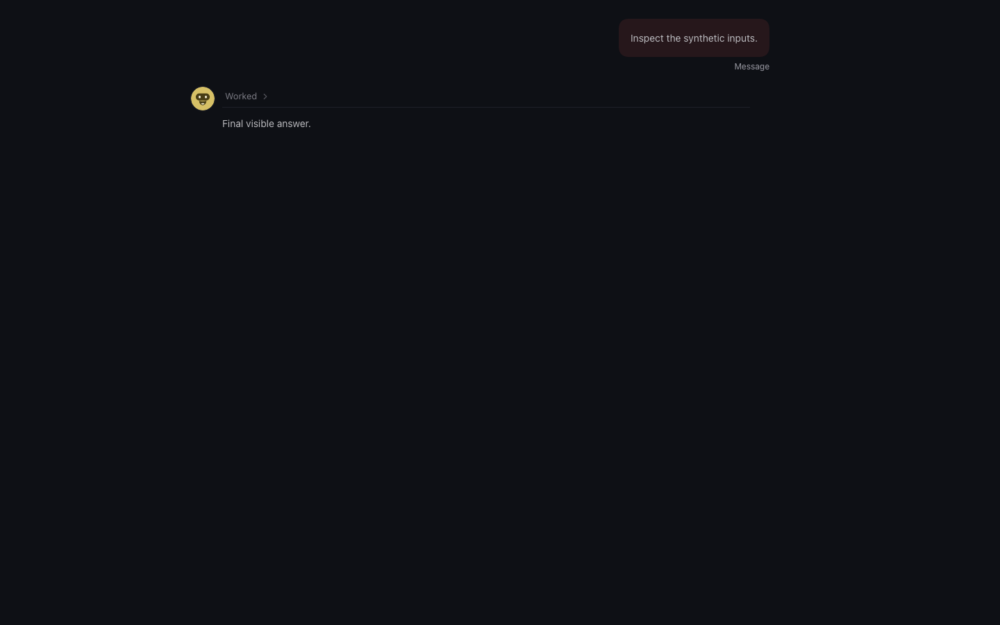
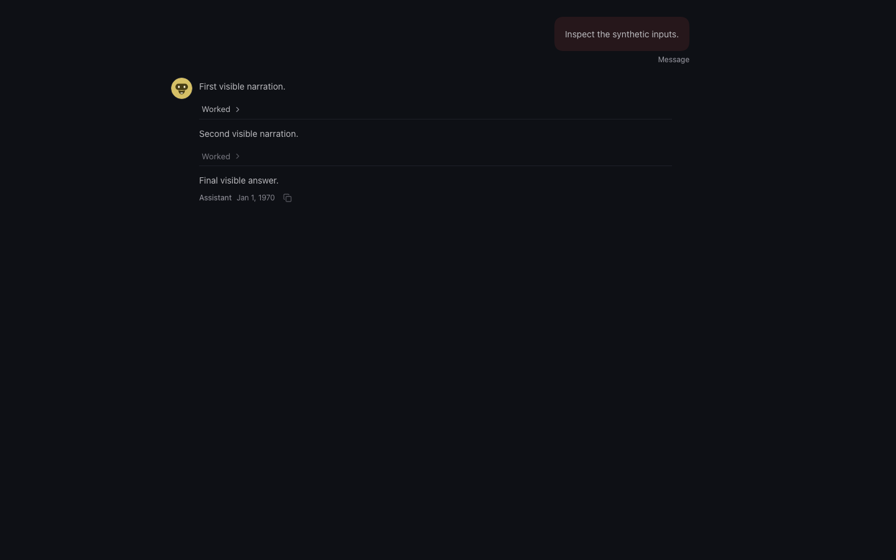
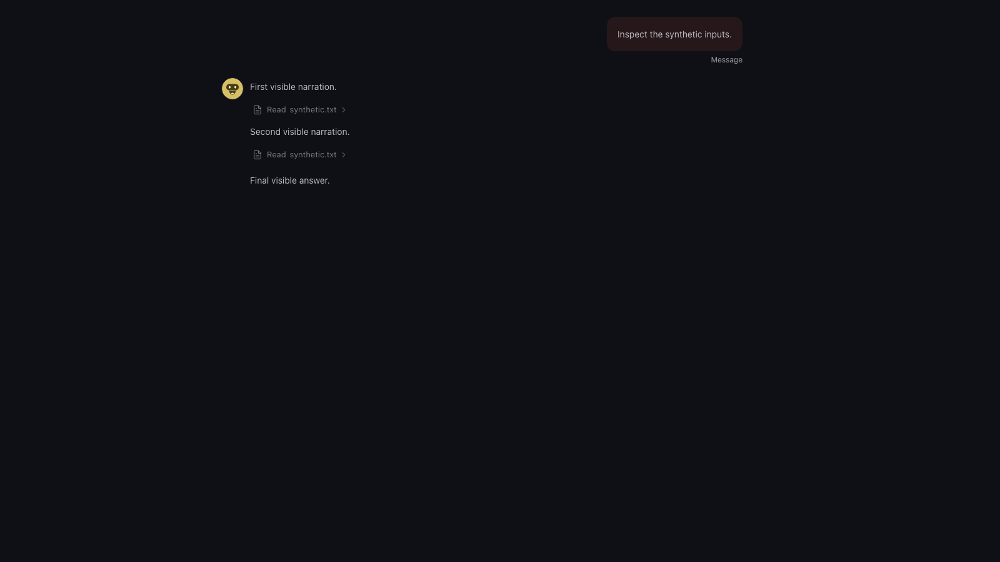
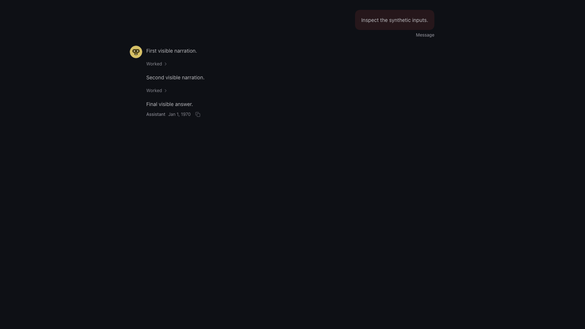

# Chat narration and in-place completed work

AI-assisted implementation. Synthetic transcript evidence exercises the production chat renderer.

## Regression evidence

- Native stock completed-work projection: five assertions fail in three regression tests.
- Restored native patch: 81 tests in eight focused suites pass.
- Web source/action negative control: 10 tests fail, 32 pass.
- Restored web patch: 242 tests in 11 focused files pass.
- Parser-context negative control: five privacy tests fail before the fix and all 28 work-chunk tests pass after restoration.
- End-to-end: 17 tests pass across five chat files.
- Chromium: two tests pass, each exercises flat and bubble presentation at 1440 and 1600 pixels, independent expansion, and reclosure.

## Screenshots

Flat mode, before:

Flat mode, after:

Bubble mode, before:

Bubble mode, after:

All PNG chunks were inspected before publication; no metadata chunks are present.
