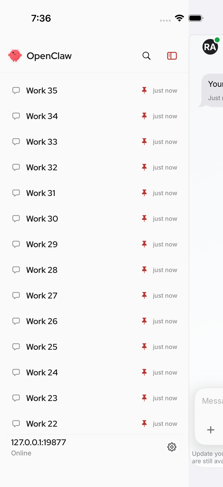
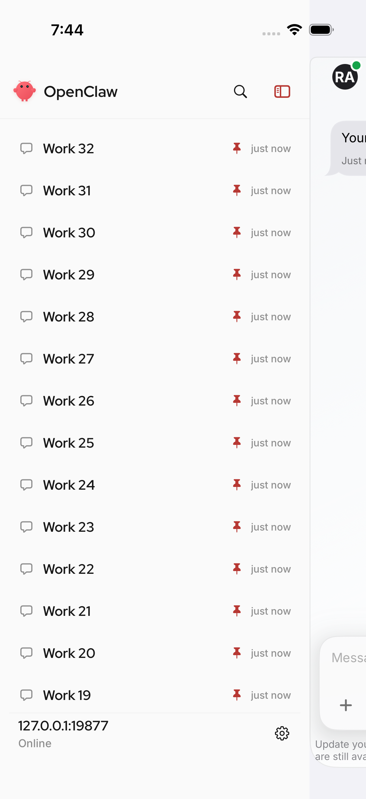
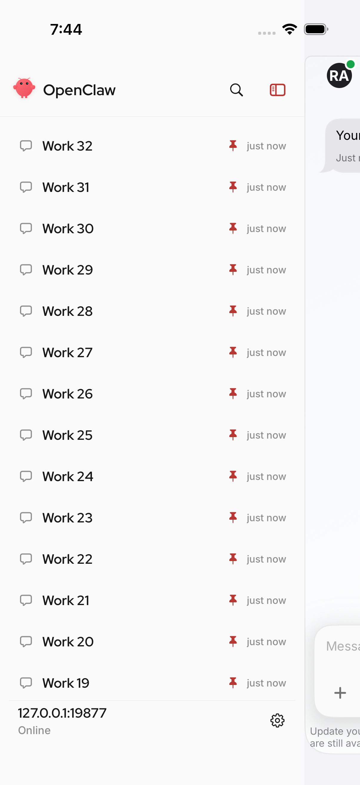

# Running-app sidebar insertion proof

AI-assisted implementation and sanitized validation record. No private chat history, credentials, or remote endpoints are included. All session titles and chat content are synthetic; the displayed address is loopback.

## Scenario
Xcode 27.2, iOS 26.5 simulator. Launch the real app, pair through onboarding to a synthetic loopback Gateway, open the sidebar, drag to scroll a 40-pinned-session roster, insert three newer pinned sessions through sessions.changed, wait for roster readback, then measure the same accessibility row and capture screenshots. No screenshot-mode roster injection or product instrumentation.

## Paired results
- Stock 38f68a10828da63adf76376ac974e92577b43f55: Work33 AX Y94.33333333333331 ->232.33333333333334; drift138.00000000000003 pt. The less-than-2pt assertion fails.
- Anchoring-only source (61b0c56de298 plus removal of memoization, published as 2b159e89c6a): Y94.33333333333331 ->94.33333333333337; drift5.684341886080802e-14 pt. One XCTest passes, zero failures, 28.849 seconds.
- The tracked Work33 frame starts clipped beneath the header. Screenshots independently show visible Work32–19 retaining their positions with anchoring; stock moves these rows down by three row heights.
- Stock XCTest restarted after the assertion and printed a later empty suite. The template incorrectly summarized zero tests; the actual test log names the executed assertion failure. This is not a setup failure.

| Run | Before | After |
|---|---|---|
| Stock |  |  |
| Anchoring only |  |  |

## Focused checks
Final anchoring-only source: 24 Swift Testing tests in two suites (RootSidebarStabilityTests and OpenClawTypographyTests) passed in2.178 seconds. Pinned SwiftFormat0.63.1 with config/swiftformat:0/3 files require formatting. Strict SwiftLint0.65.1 with apps/ios/.swiftlint.yml:0 violations in two production files. Simulator lint phases were bypassed for baseline violations; these scoped lint checks ran separately.

The original session button is restored. No memoization, equality suite, rendering-performance claim, or private proof fixture ships in the PR. Prior hosted captures before.png/after.png remain historical evidence only; use the running-app captures above for current proof.

Known limitation: removal of the chosen anchor row is not corrected. Top-of-list and active scrolling are excluded. No physical-phone or deleted-anchor proof is claimed.
