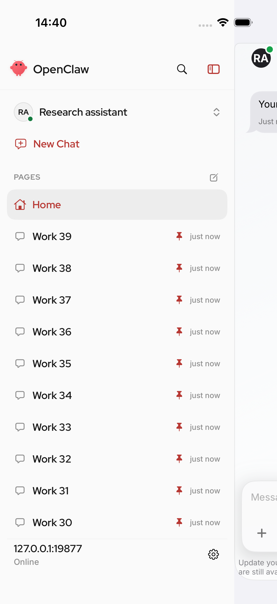
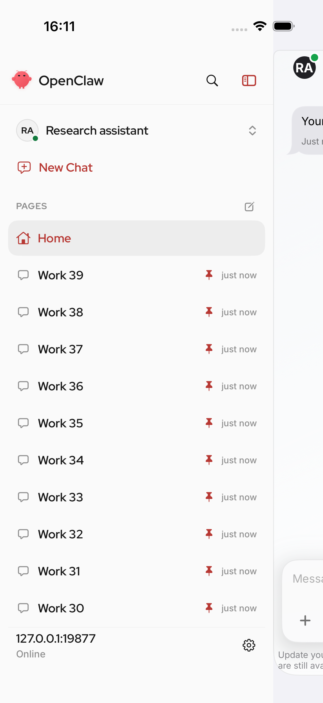

# Sidebar row body-evaluation proof

Synthetic 40-session roster; 12 updates change only Work 39 unread. Same extracted body boundary, upstream base, simulator and workload. Control differs only by removal of Equatable conformance and .equatable().

| Post-initial body evaluations | Control | Candidate |
|---|---:|---:|
| Unchanged rows |936|0|
| Changed row |24|12|
| Total |960|12|

Each paired run: one XCTest, zero failures. Separate boundary test asserted all 12 unread transitions. Native selection test checked Work39 then Work38 history requests and Rename open/cancel: one XCTest, zero failures. Screenshots show unchanged geometry, not a visual performance measurement.
Final equality and typography suite: 25 tests in 2 suites passed (3.870 seconds).
Two independent prefiling reviews found no blocking correctness defects. Callback-stability and minute-bucket freshness constraints are documented.
No CPU, FPS, latency or physical-device improvement is established. No idle timer was added; relative labels may remain stale until a parent refresh. Rename persistence was not tested. Simulator build lint phases were bypassed; pinned strict SwiftLint separately passed all three changed files with zero violations.

