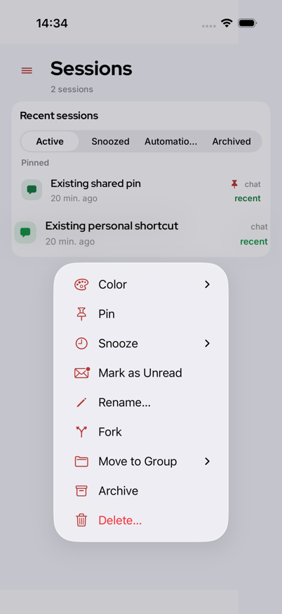
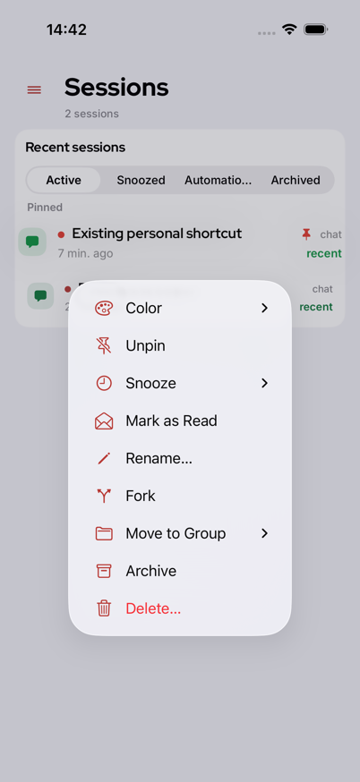
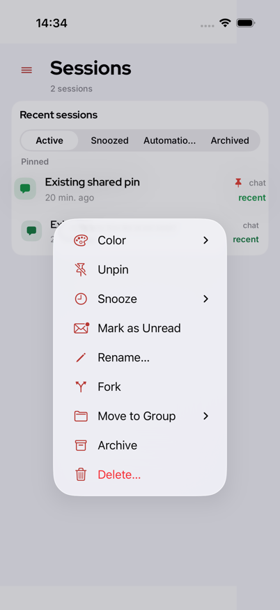
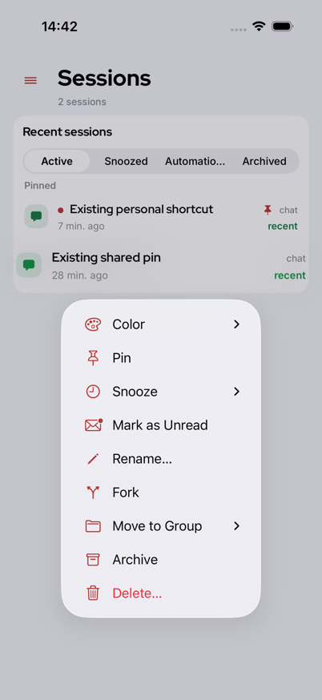

# iOS personal session pins — validation for PR #199685

**Two-profile isolation and cross-client refresh.** The exact PR iOS build ran against an isolated Gateway. An independent Owner RPC client pinned X, and iOS offered Unpin for X. A pin belonging only to profile B still offered Pin in the Owner app. After the Owner unpinned X in iOS, a separate Owner RPC read confirmed neither X nor Y was pinned for Owner. The [RPC/XCTest output](native-rpc-xctest.txt) and [two-profile storage readbacks](profile-isolation.jsonl) are included. This was RPC-to-iOS and iOS-to-RPC, not a rendered browser test.

**Profileless denial.** Gateway handler tests cover the typed `no_durable_identity` result. The native method harness verifies that this response produces the profile-required explanation after one read and attempts no write. This is contract coverage, not a live profileless simulator run.

**Seeded upgrade.** One XCTest passed on v2026.11.5 and one on the exact PR iOS build, using the same simulator without erasing its data. Before upgrade, the legacy shared session offered Unpin and the personal shortcut offered Pin. After upgrade, the shared session offered Pin and the personal shortcut offered Unpin. The isolated Gateway required an offline schema migration. The [stable seed](stable-store.json), [stable post-UI](stable-store-after-ui.json), [head pre-UI](head-store-before-ui.json), and [head post-UI](head-store-after-ui.json) readbacks match byte-for-byte, including the legacy pin timestamp. No data was reseeded. The upgrade test did not check chat-history retention or compare against the exact merge base. Targeted simulator runs bypassed lint.

| Fixture | Before | After |
| --- | --- | --- |
| Existing personal shortcut |  |  |
| Existing shared pin |  |  |

[Stable XCTest output](upgrade-stable-xctest.txt) · [Head XCTest output](upgrade-head-xctest.txt) · [Public web parity rationale](WEB-PARITY.md)
