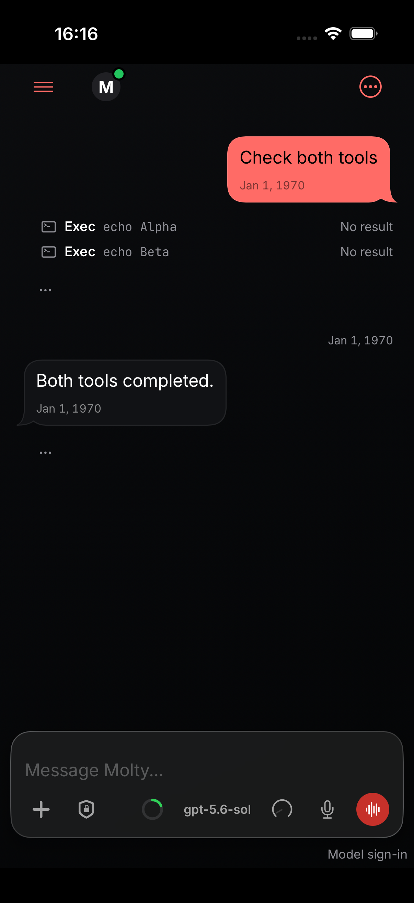
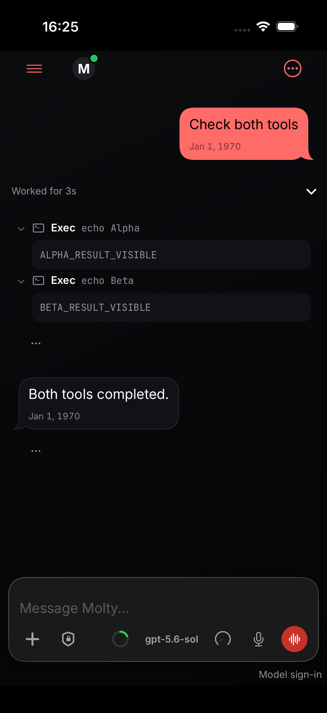
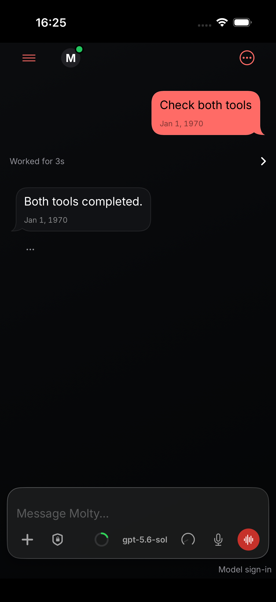

# iOS parallel tool results

Two exec calls return their outputs in one user-role carrier. Before the fix, both calls show “No result”; afterward, each output appears under its originating call in completed work. These screenshots use a synthetic iOS Simulator fixture.

## Before

## After

[Focused validation output](test-output.md) · [AI-assisted session log](session-log.md)
