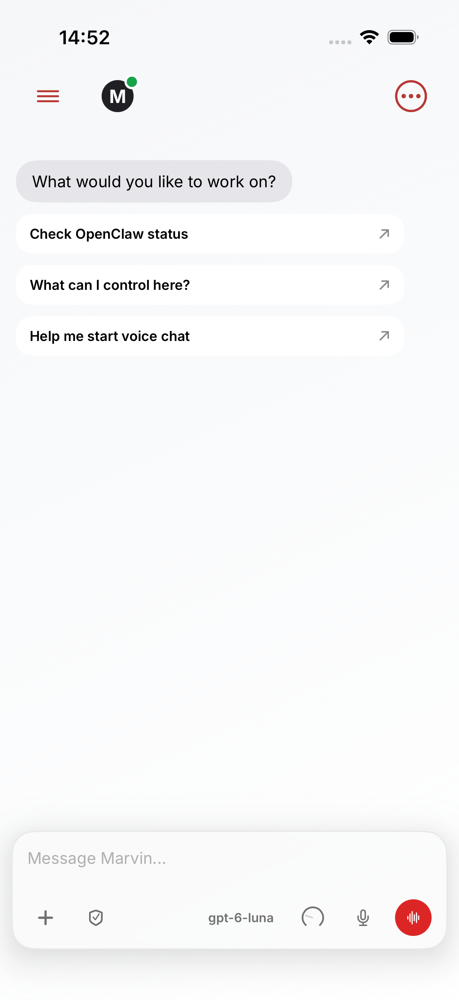
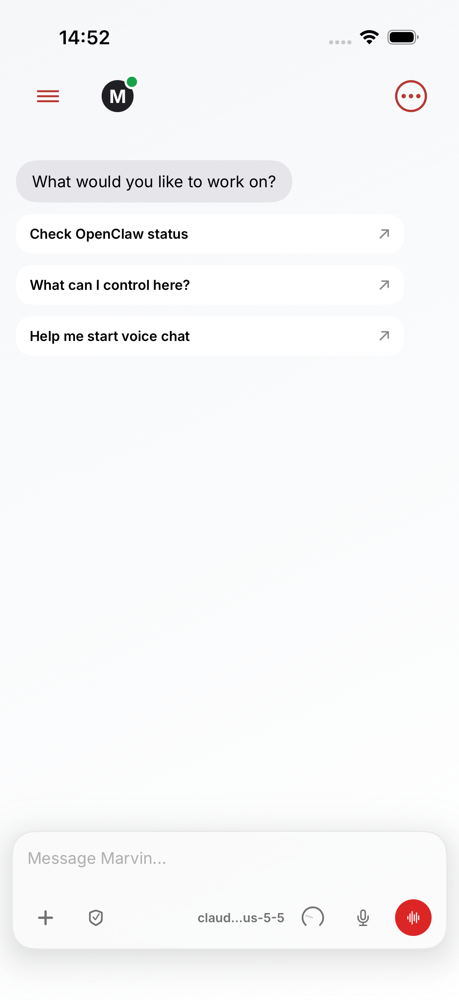
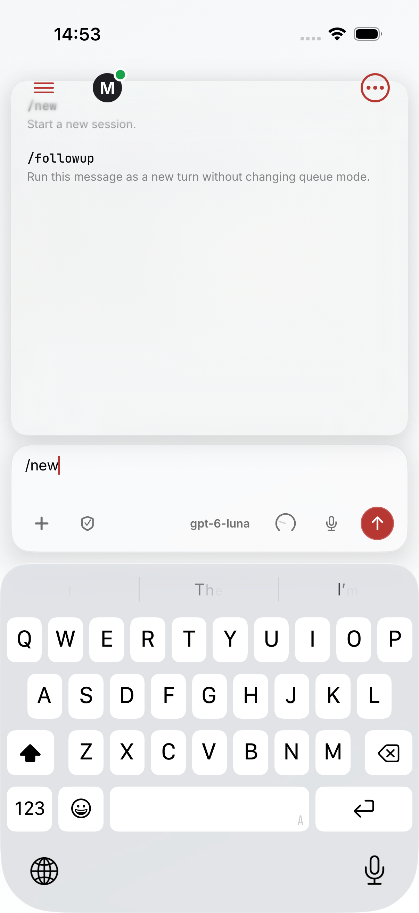
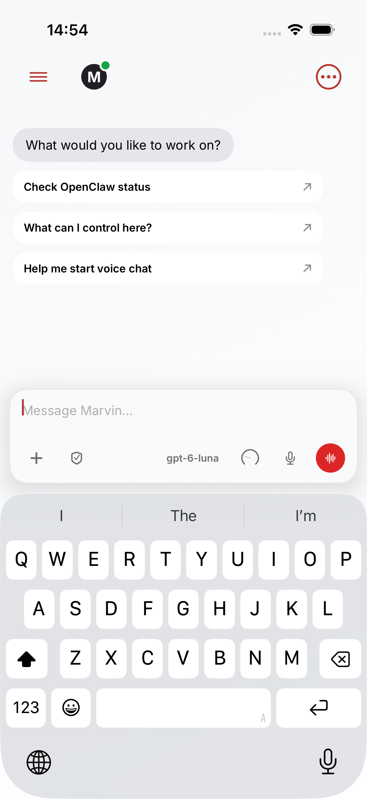

# Native New Chat web parity — AI-assisted working log

Base: d921a2bfcc4e0aeeec199381b73403d51cced607
Change: 6daf2b7f31c

## Intent and implementation

Sidebar/global New Chat starts independently with Gateway defaults. In-chat `/new` remains an explicit child and retains Gateway parent-selection inheritance. The existing native session creation owner receives an internal inheritance-intent flag; global callers use false and only `/new` opts in. Direct and captured-route creation use the same decision. Existing agent identity, advanced options, admission, stale completion, and unsupported transport guards remain.

## Regression proof

Prepared native Mermaid resources using `node scripts/prepare-apple-mermaid.mjs`.
Tests used Xcode 27.1 and `nice -n 15 swift test --package-path apps/shared/OpenClawKit -j 2 --filter ChatViewModelSessionActionTests`.

Stock source with regression assertions:

```
sidebar new chat does not inherit the selected conversation:
  ordinary/direct: FAIL (parent unexpectedly present)
  ordinary/captured: FAIL (parent unexpectedly present)
  Home/direct: FAIL (parent unexpectedly present)
  Home/captured: FAIL (parent unexpectedly present)
sidebar creation with active agent identity omits parent for an unscoped current key: FAIL
slash new retains parent for gateway settings inheritance: PASS
Test run with 46 tests in 1 suite failed after 0.197 seconds with 5 issues.
```

Patched:

```
Suite ChatViewModelSessionActionTests passed after 0.201 seconds.
Test run with 47 tests in 1 suite passed after 0.201 seconds.
```

Final formatted commit plus agent-navigation boundary:

```
Suite ChatViewModelAgentNavigationTests passed after 0.183 seconds.
Suite ChatViewModelSessionActionTests passed after 0.198 seconds.
Test run with 65 tests in 2 suites passed after 0.198 seconds.
```

Scoped SwiftFormat passed. Scoped SwiftLint exited zero with four existing long-line warnings outside the change.

## Review

Codex review: no actionable findings. Cross-family review: no actionable findings.

## Live proof

Native simulator build and XCUITest driver passed. From an ordinary chat with a nondefault model, sidebar New Chat emitted only a fresh key (no parent or overrides), and independently queried session metadata used the agent default model. In-chat /new emitted the owned parent key, and independently queried metadata retained the nondefault model. Screenshots confirmed both outcomes. No model turns were needed. All three owned sessions, simulator, and paired device were removed and checked absent.

## Inspected native screenshots

All images show disposable empty chats, with no private conversation or credentials. PNG ancillary metadata was removed before publication.

### Owned parent with nondefault model



### Sidebar New Chat uses agent default



### In-chat /new from nondefault parent



### In-chat /new retains parent model



