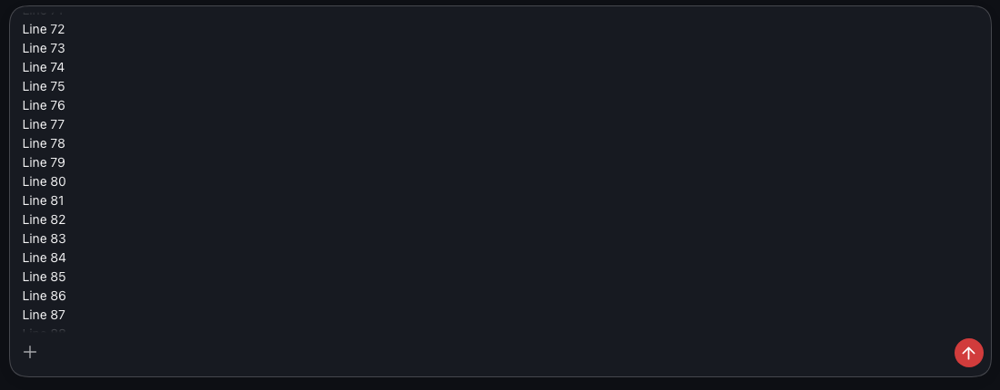
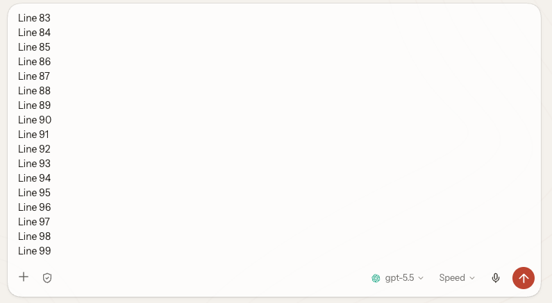

# Composer width, draft growth, and shrink anchoring

Synthetic drafts are shown; screenshots are cropped to the composer.

## Before

The regression browser fixture at a 1440 × 600 viewport leaves the end of a 100-line draft below the visible editor after the window shrinks.

## After

The production preview at the same viewport keeps Line 99 visible after shrinking from 900 px high. When the caret is near the top, scrolling stops at the caret line instead.

## Validation

- Rebased composer validation: 41 Chromium tests, 94 focused unit tests, and 48 full-app E2E tests passed.
- The three shrink regression cases fail without the product fix. The two affected browser suites pass with it: 28 tests, including end-caret anchoring, near-top caret visibility, and stable growth back.
- The rebuilt production preview passes 12 shrink/grow scenarios across Chat and New Session at 1440 and 1600 px.
- UI typecheck, scoped lint and formatting, controller guard, production build, and diff checks pass.
- Range comparison found changed display integrations for upstream mobile layout, New Session connection readiness, and shared shell CSS. Shared geometry and pointer-drag modules are unchanged. The boot manifest adds only the two shared composer modules.

The regression fixtures and product behavior are in the pull request source; no assertions were relaxed.
