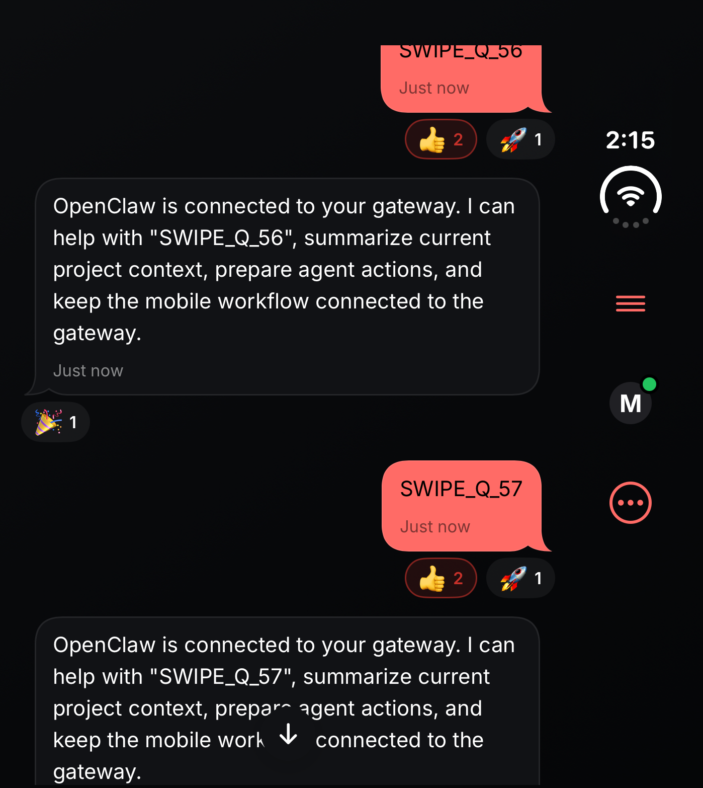
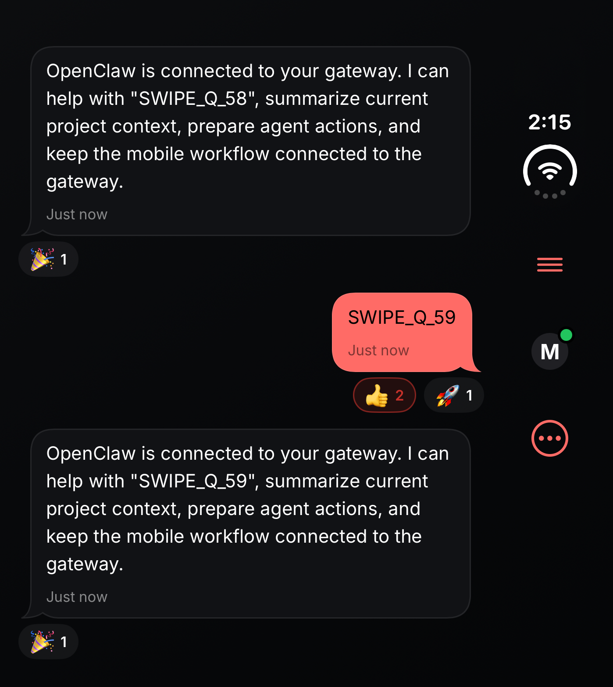

# Native simulator swipe proof for #165948

Base d20f161513f7693e8f4c64a748e111e40632350d; candidate cde4f192254351cb9ea8cd5b58830cb29ccc0666. Xcode 27.1, iOS Simulator, CI-mode GITHUB_ACTIONS=true, two build jobs. Identical scratch-only instrumentation counts body, transcript preparation, and row-builder entries; not committed to the PR. No fixture adaptation: 60 Q&A pairs created through the unchanged empty local demo chat UI on each side. 16 native XCUITest swipes (8 down, 8 up). Both native tests passed.

Base: 33 body / 33 preparation / 33 row-builder evaluations. Candidate: 0 / 0 / 0. Each trace contains 16 interacting, 16 decelerating, 16 idle transitions in the bounded swipe interval. Counts exclude setup and subsequent jump test. Timestamped traces and markers permit recounting. One matched simulator run, not a device frame-rate or latency claim. Synchronous scratch trace writes may affect timing; no timing improvement claimed.

After swiping away, jump appeared; tapping hid it and returned to visible final answer SWIPE_Q_59. Screenshots personally inspected; bottom composer cropped to omit unrelated model configuration.

