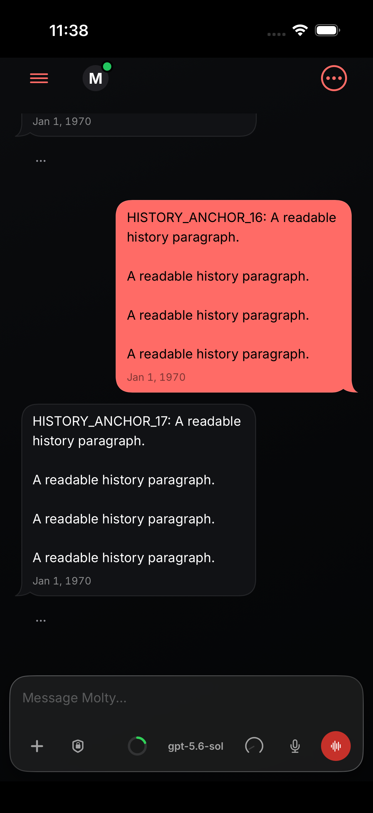
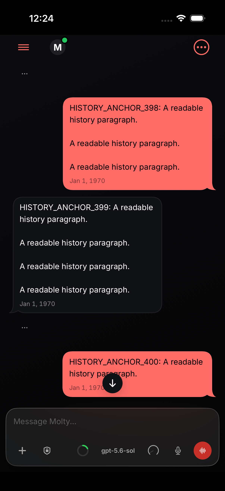
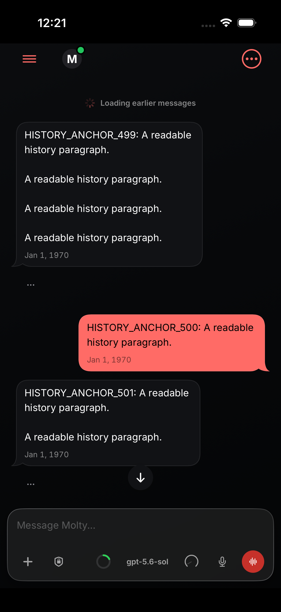
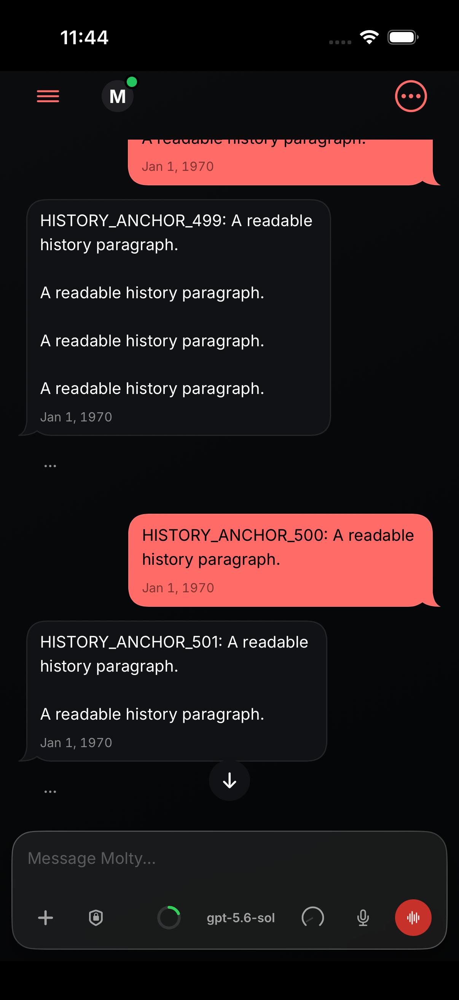
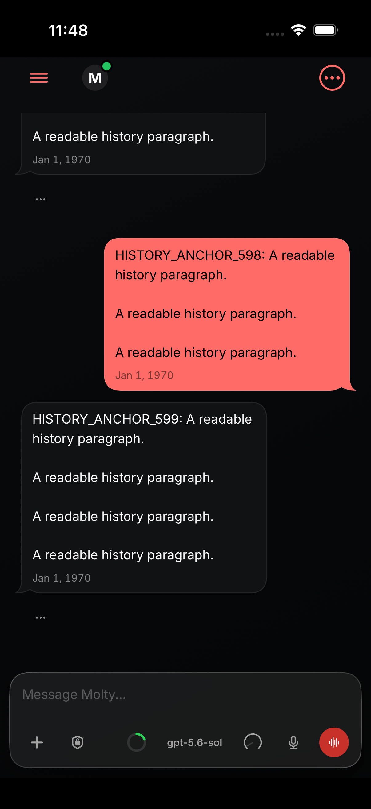
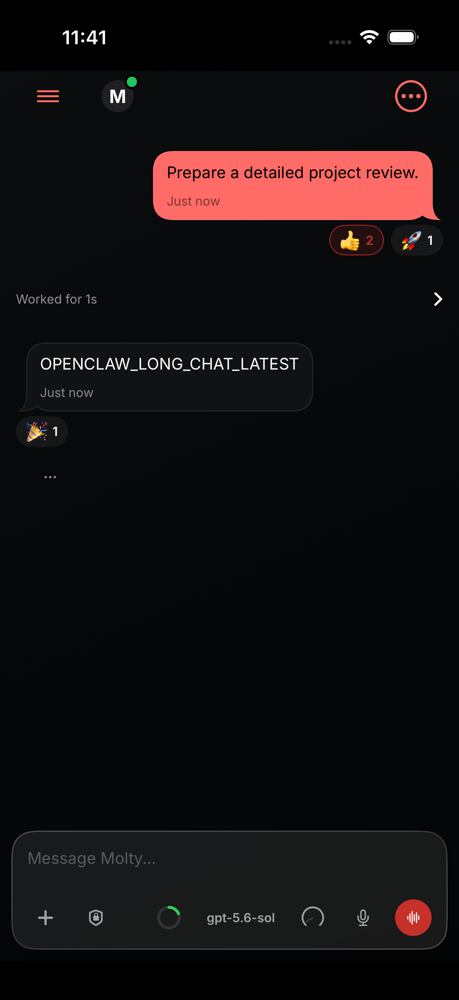
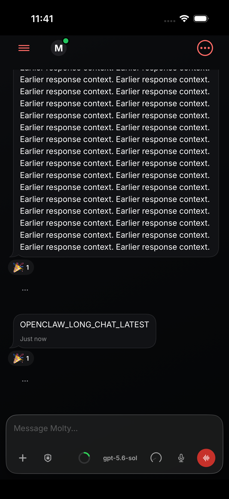
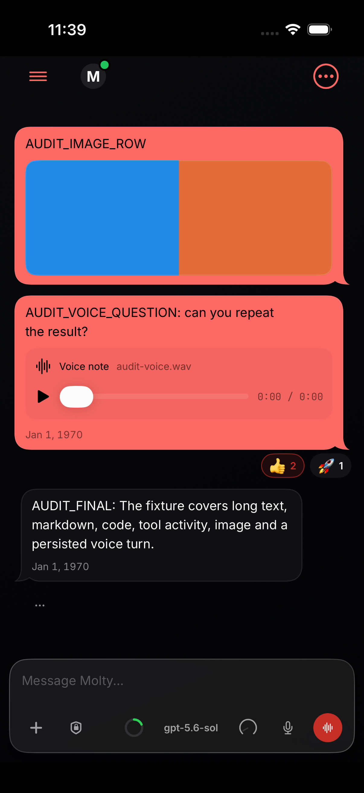

# #163153 native evidence, head c243a3ea9ef

iPhone 17 / iOS 26.5 simulator, fixture transcripts only. Images are unedited simulator captures; `results.json` holds the test results, including the failures disclosed in the PR body; `pixel-alignment.json` holds the rendered-row alignment check.

## current-head-first-page-delayed-metadata

## fallback-controlled-398-after

## fallback-controlled-398-before

## fallback-controlled-499-after

## fallback-controlled-499-before

## long-history-after-prepend-398

## long-history-after-prepend-499

## long-history-before-prepend-398

## long-history-before-prepend-499

## long-history-true-latest-opening

## long-history-true-latest-return

## presentation-completed-work-collapsed-again

## presentation-completed-work-expanded

## presentation-completed-work-initial

## probe-decelerating-after

## probe-stall-touch-after

## rich-first-page-before-metadata

