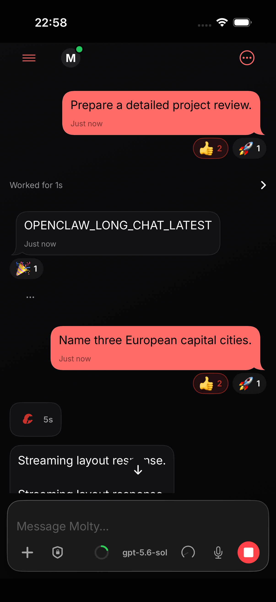
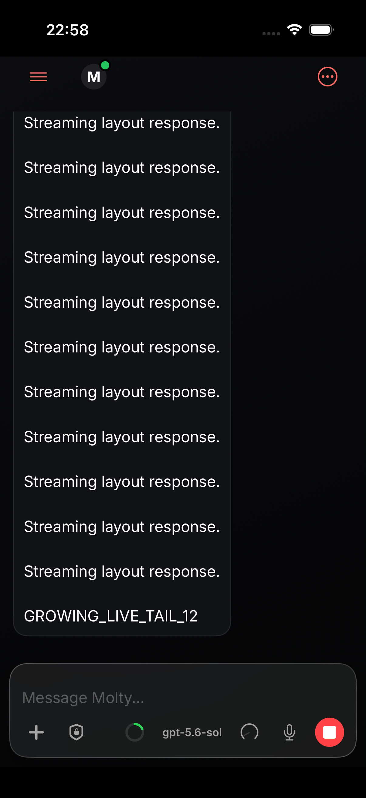
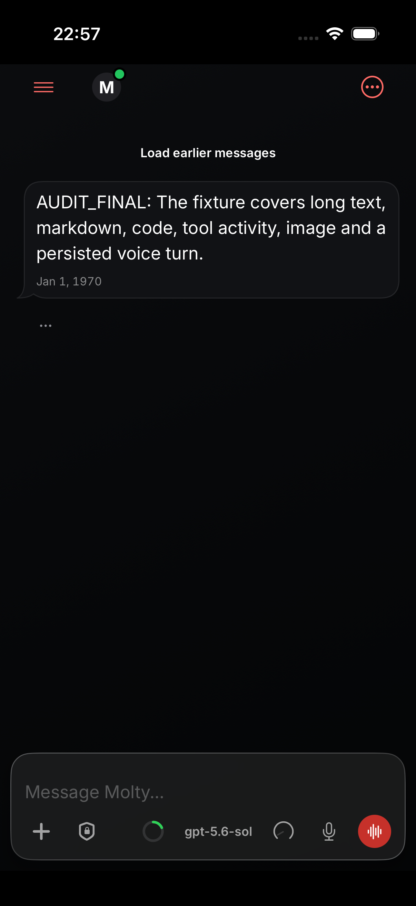
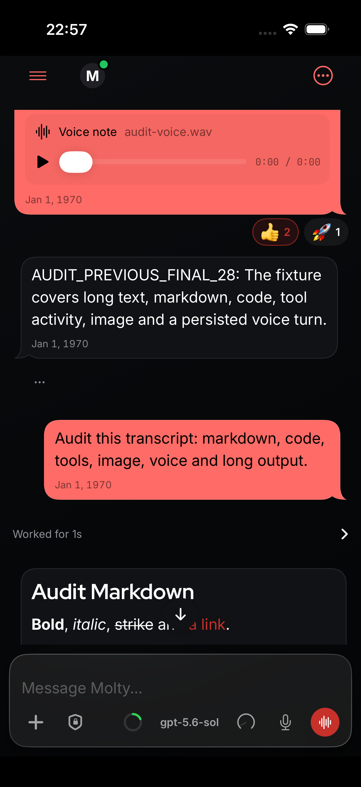
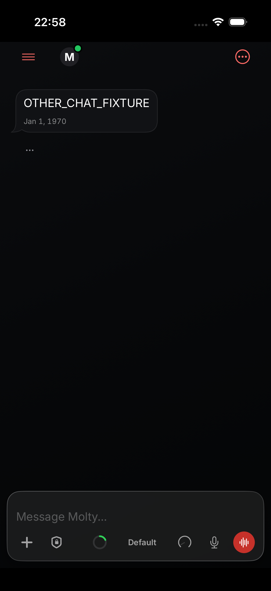
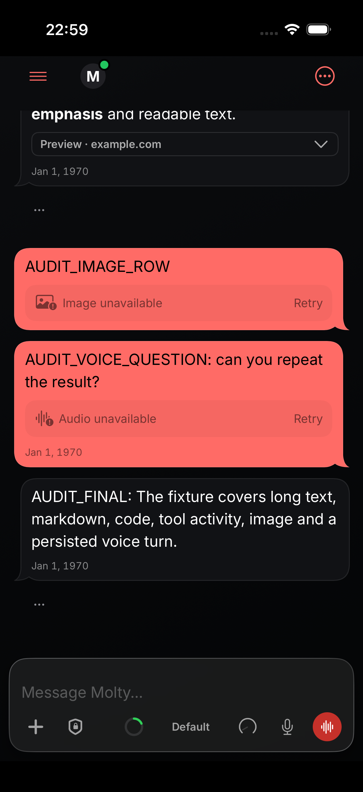
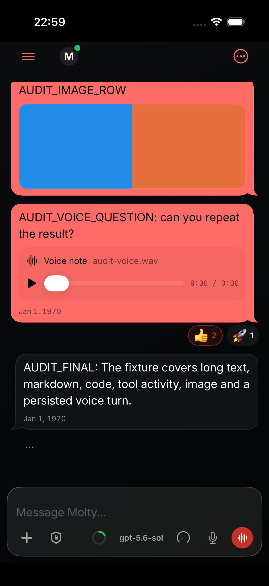

# Native reader-position validation

Fresh simulator validation of source commit d4df45278320bcb9553d181972b7f88318a9a07e.

## Streaming question anchor

The sent question remains visible after keyboard dismissal and twelve response chunks; explicit jump reaches the growing latest tail.

## Earlier history

The explicit earlier-history button loads its page before optional metadata settles. The loaded replies remain readable after scrolling to them.

## First page before metadata

The final fixture reply is rendered 18.833 seconds before the first optional-metadata completion.

## Cached latest return and refresh

The proof uses an isolated instance of the production SQLite cache, verifies a populated scoped read and distinct alternate-session navigation, then returns to the primary session. The cache reads 200 rows. The cached latest screenshot is captured 3.331 seconds after the return tap, before live history at 20.727 seconds. The finite/hittable/pixel-verified capture is at 10.985 seconds; optional metadata completes at 42.622 seconds. The refreshed capture is at 48.581 seconds. Latest reply y changes only 0.041667 points. The iOS return contract is latest/live edge.

All three UI tests passed. Focused chat kit checks passed 515 tests in 13 suites; native prepend viewport checks passed 2 tests. Native i18n verification and scoped source SwiftLint passed. Exact test durations and timing values are in [runtime-results.json](runtime-results.json).

The temporary proof fixture, cache observer, UI harness and simulator project adaptations were restored after testing. The lane-owned simulator was deleted. Screenshots contain synthetic fixture data, were visually inspected, and had nonessential metadata removed without changing pixel data.
