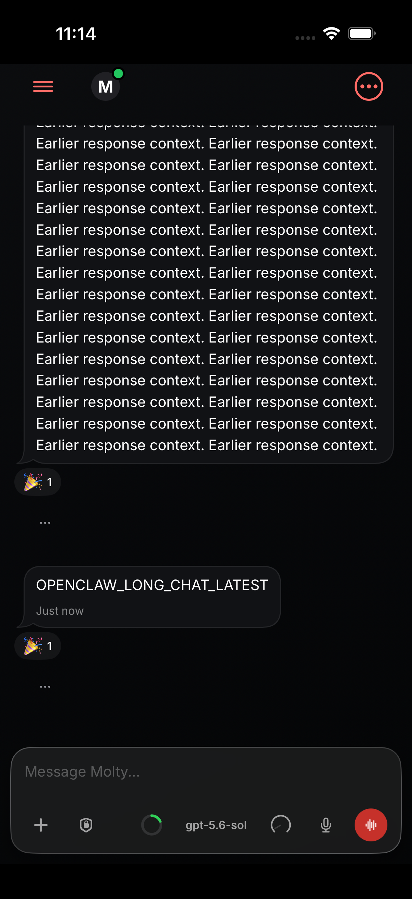
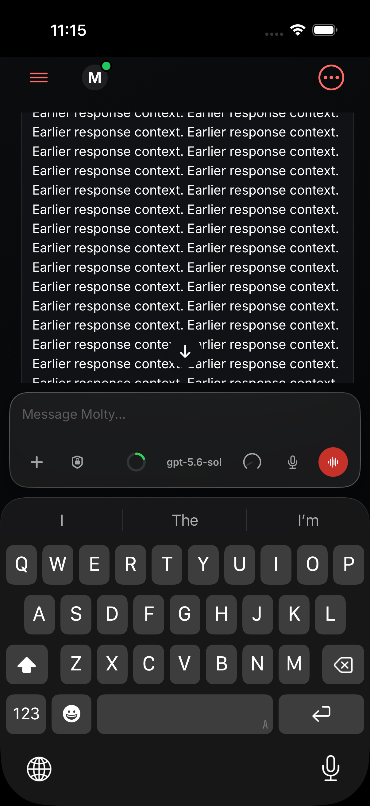

# Completed-work disclosure retention

Tested source commit: `025f208a286de84530a52574227bbe2a5946780d`. Baseline: `17f192d79cd18a480278dea81abe2c9335ee9d5f`.

The same UI regression runs with baseline and fixed ChatView source, using the existing long-chat fixture. It opens the seeded completed-work disclosure, sends six completed user/reply pairs crossing the former warm-history boundary, and never reopens it.

- Baseline: regression fails at line 1202, “Expanded work must remain open when new turns move it into older history.”
- Fixed: all five selected UI tests pass, zero failures: retention, completed-work final-reply visibility, long-transcript fling, earlier-history reading position, and manual reading during tool streaming.
- Final screenshot independently inspected: expanded Earlier response context is visibly readable in the transcript after six new turns. Readability requires at least 44 points of text/viewport intersection; tall noninteractive text is not checked using isHittable.
- SwiftFormat 0.63.1 passes both files. SwiftLint 0.65.1: ChatView passes strict lint; UI-test baseline and fixed reports each contain 11 inherited findings, with zero added findings after mapping unchanged lines. Existing file/type-length findings remain.
- Both source hashes match the local committed bytes and were unchanged after testing; see results.json.
- iPhone 17 Pro/iOS 26.5 simulator, Xcode 26.6. Scratch setup omits Watch dependency and replaces broad lint phase with focused lint; source and SwiftFormat phase retained. No phone installation or new performance benchmark.

[Test summary](test-summary.log) · [Red log](red-test.log) · [Green log](ui-tests.log) · [Results](results.json) · [Lint delta](lint-delta.json)

Before appending turns:

After six new turns, without reopening:

## Review cleanup

Final publication head: `261fdcc0bb5c7aab3ed236cdc2b56d77d646ca42`. After the paired run, removed the now-unused `ChatAssistantRunGroup.eagerHistoryStart` helper and its obsolete comment. Repository search confirmed there were no remaining call sites. SwiftFormat 0.63.1, strict SwiftLint 0.65.1 (zero findings), and Swift parser passed for this deletion-only file. The simulator-tested ChatView and UI-test hashes remain identical on the final head; no new simulator run is claimed for the unused-helper deletion.
