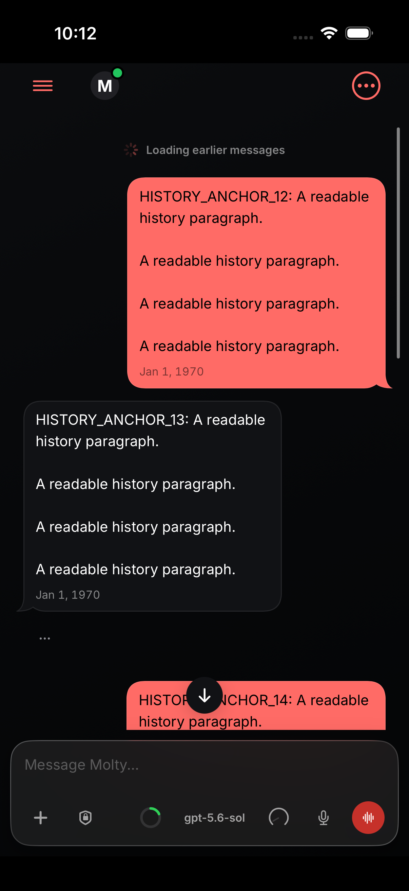
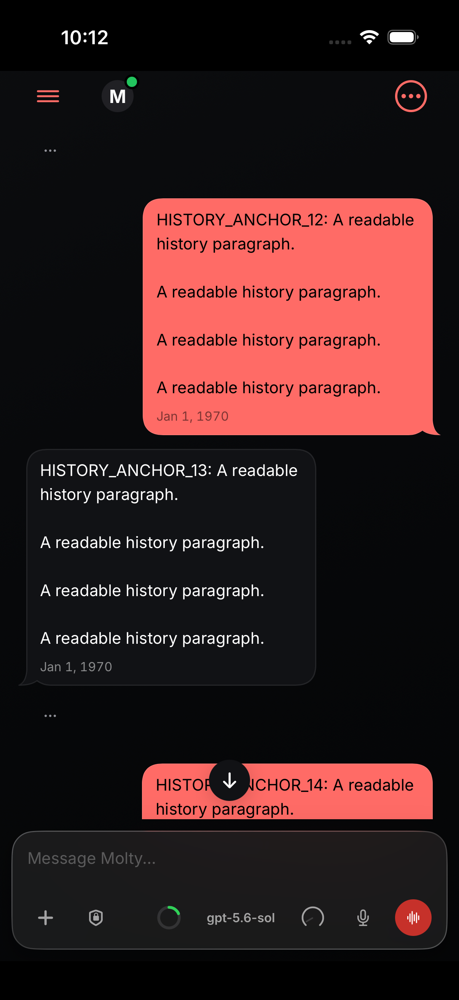
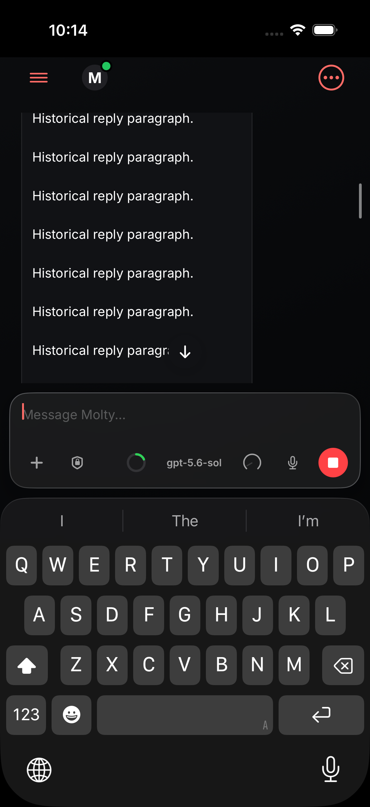
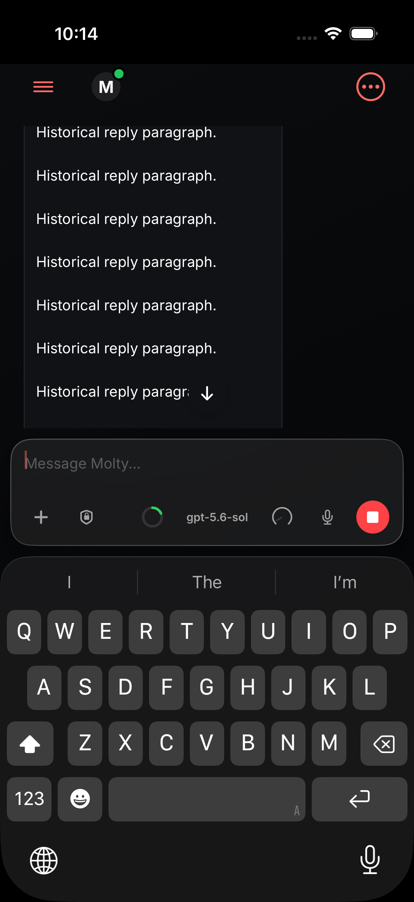
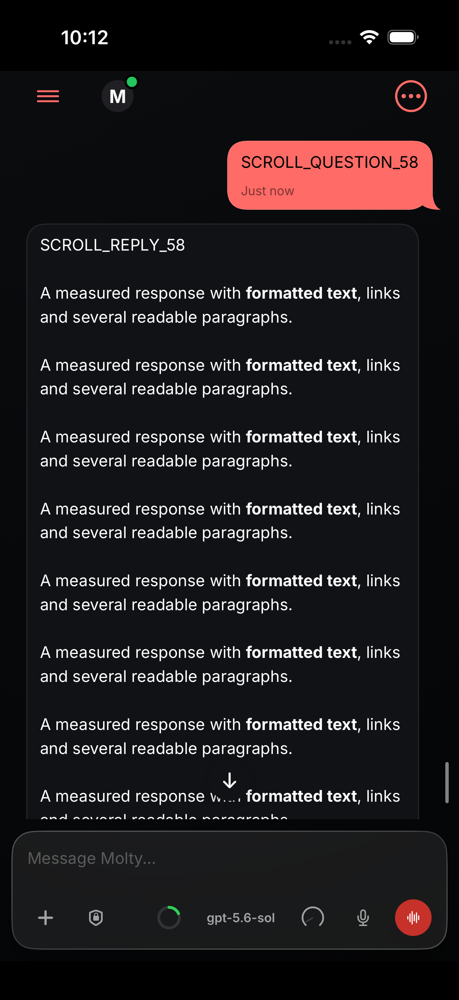
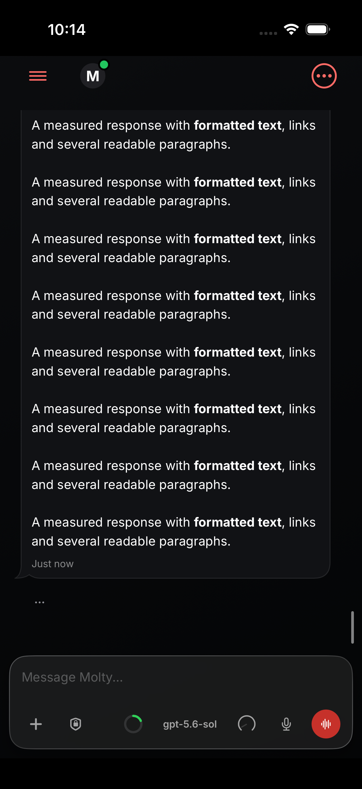

# Rebased iOS scroll validation

Tested head: `17f192d79cd18a480278dea81abe2c9335ee9d5f`  
Base: `05bc4bf5c9fc717841df38d169bb69fa3d88a52a`

- SwiftFormat 0.63.1: two-file lint passed.
- SwiftLint 0.65.1: both changed scroll-state files passed strict lint.
- `swift test --filter Chat --jobs 2`: 1,784 tests in 133 suites passed.
- iPhone 17 Pro / iOS 26.5 simulator: all three UI tests passed (0 failures): long-transcript fling scrolling, loading earlier history preserves reading position, and manual reading during tool streaming.
- Source hashes were checked before and after tests; terminal result and tool versions are attached.
- Simulator-only verification; no phone build or installation.

The isolated Xcode project omitted the Watch dependency and replaced the broad lint build phase with focused direct strict lint. Its SwiftFormat phase and tested source were retained.

This run checks behavior after rebasing; it does not repeat the earlier body-invalidation benchmark or establish physical-device latency/frame rate. The earlier 82-to-0 result remains historical, at the revisions documented in [the paired benchmark](../README.md). This run does not add baseline-red paging proof.

## Terminal evidence

[Results and source manifest](results.json) · [Tools](tool-versions.log) · [Chat test output](chat-tests-summary.log) · [UI test output](ui-tests-summary.log) · [Formatting](format.log) · [ChatView lint](lint-ChatView.log) · [Scroll command lint](lint-ChatScrollCommand.log)

## Synthetic simulator screenshots

| Scenario | Before | After |
| --- | --- | --- |
| Earlier-history prepend |  |  |
| 20 tool-stream updates while reading |  |  |
| Long-transcript fling sequence |  |  |
