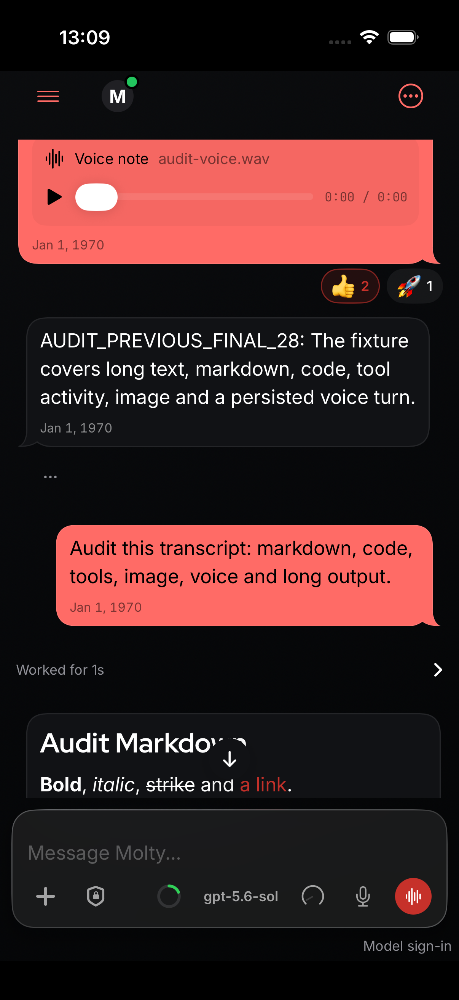
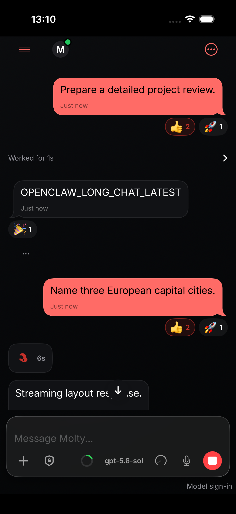
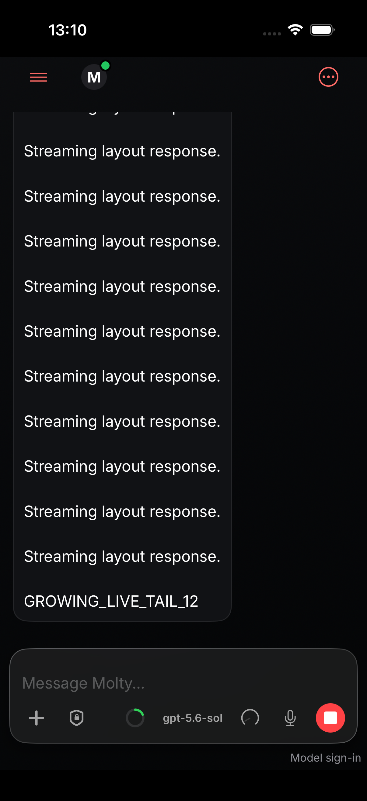
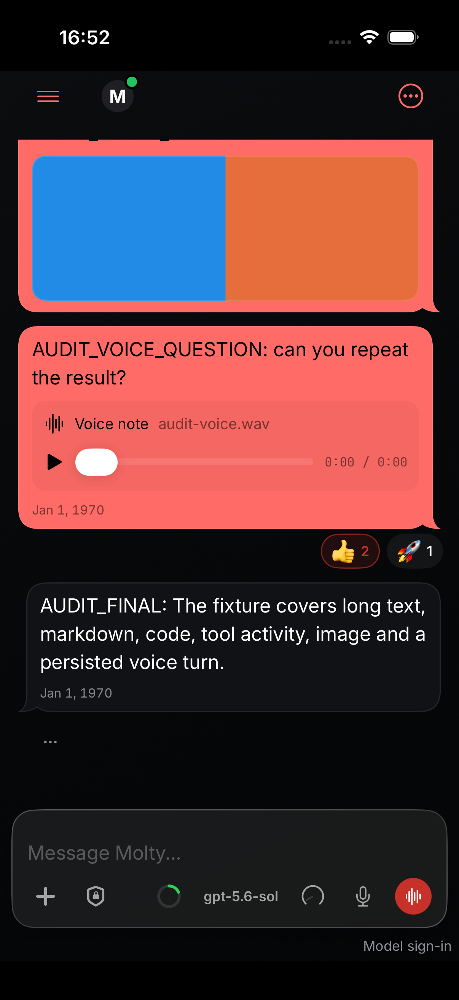
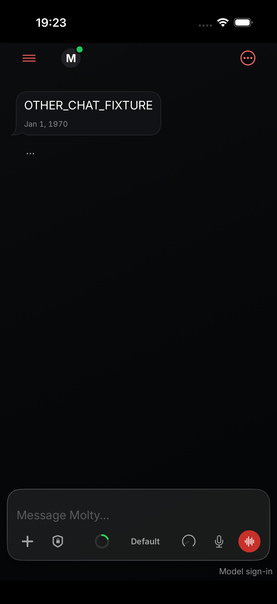
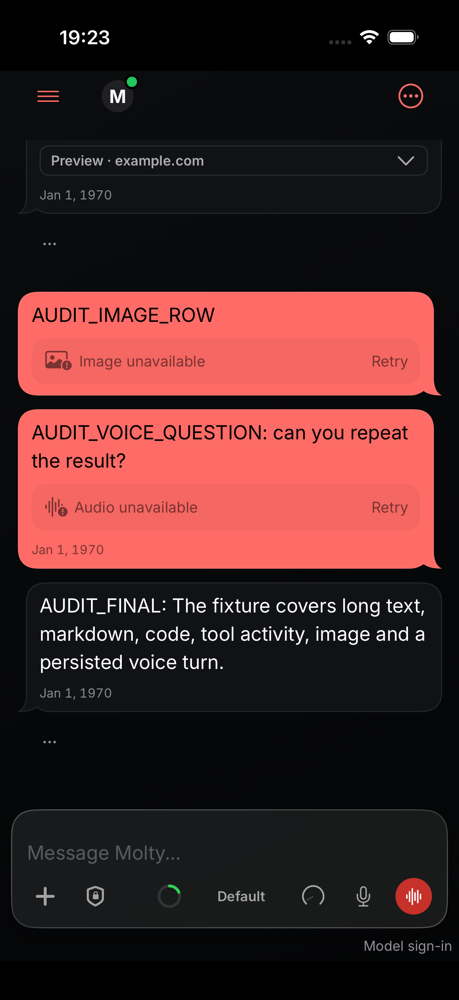

# iOS reader-position evidence

Product commit: `853013e4df643371bb219a122e9c0b5f49f94fb0`.
Target: iPhone 17 simulator, iOS 26.5. All messages are synthetic fixture content.

## Native flows

| Flow | Observed result |
| --- | --- |
| Load earlier history while models refresh | Earlier replies load through the explicit history button; native test passed in 28.542s. |
| Stream a reply after sending with the keyboard hidden | Question stays visible through 12 reply chunks; explicit Jump to Latest reveals the tail; native test passed in 19.956s. |
| Return to a cached session and refresh | Latest reply appears from SQLite before live history completes; native test passed in 102.244s. Its y position changes from 519.00pt to 519.04pt after refresh. |

[Native test receipts](native-proof.txt), [preserved flow receipts](preserved-native-passes.txt), [source timestamps](source-events.jsonl), [timing](timing.json), and [scratch proof fixture/test patch](scratch-proof.patch).

## Cache and navigation setup

The proof uses an isolated `OpenClawClientDatabases` SQLite store injected through the chat owner's existing `transcriptCache` argument. The app-side preflight populates and reads the primary transcript, verifies distinct alternate content and registered primary/alternate keys, and produces [this receipt](cache-navigation-preflight.json) before the UI test starts. The UI flow creates a new chat and returns through Overview to Molty. The cache is populated again by ordinary live-history persistence before leaving the primary session.

The authoritative primary-history response is delayed 20s after the alternate session exists, to separate cache paint from live refresh. Optional models retain the existing 20s delay. Cache and scroll product methods are unchanged. iOS reopens at the latest reply; the stable-position comparison is between cached latest and refreshed latest.

| Return event | Seconds after return tap |
| --- | ---: |
| Primary history requested | 0.220 |
| SQLite read: 200 primary rows | 0.224 |
| Cached latest reply capture | 10.754 |
| Authoritative primary history delivered | 20.226 |
| Optional models completed | 42.235 |
| Latest reply after refresh capture | 48.810 |

The test retains the 4s return-existence wait and independently requires a finite positive reply, transcript and real window, viewport intersections, hittability and rendered pixels. The post-refresh position tolerance is 12pt; the measured difference is 0.042pt.

## Rendered captures

### Earlier history loaded

### Question during streaming; tail after explicit jump

 

### Cold first page while optional models refresh

This retained first-page capture is 8.218s after launch, before the fixture's 20s model delay. Its direct finite/hittable visibility check completed at 14.961s.

### Distinct alternate chat; cached latest; latest after refresh

  

Images contain no text, EXIF or timestamp metadata. The native proof uses full-screen captures plus source timestamps; no audio is published.

AI-assisted validation.
